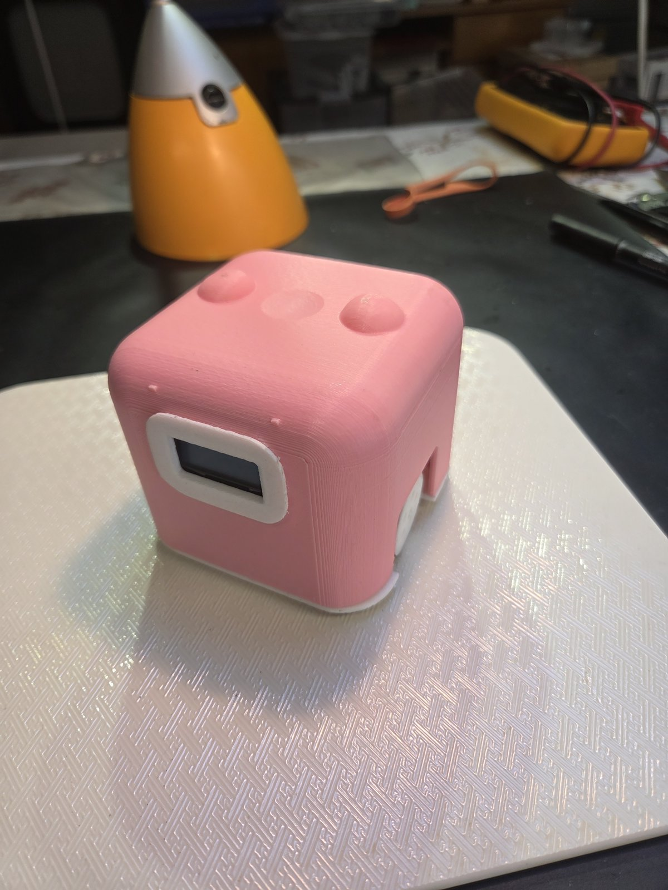
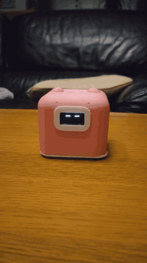
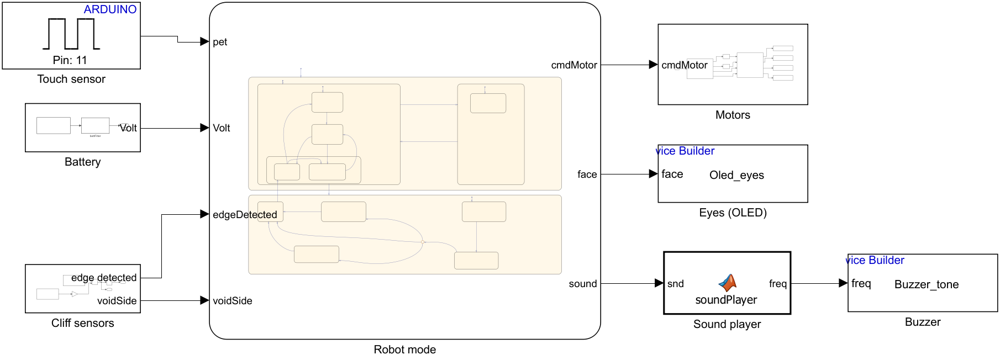
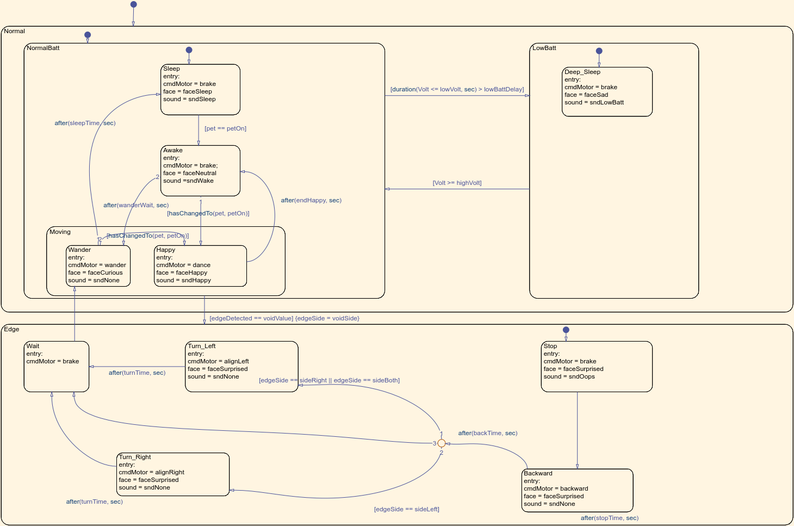
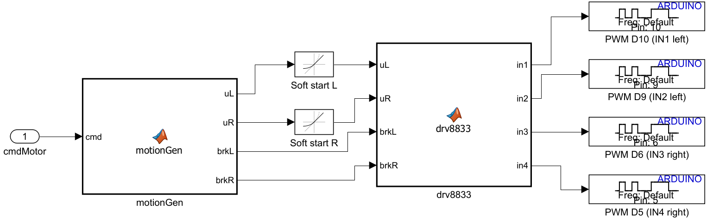
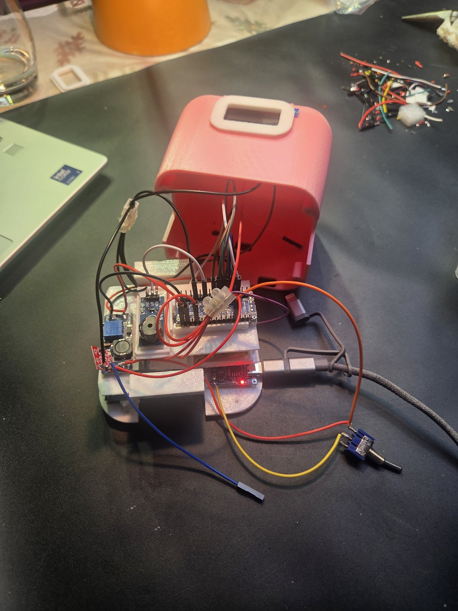

# Rosita, a Desk Companion Robot (Simulink + Stateflow)

<p align="center">
  
  &nbsp;&nbsp;
  
</p>

<p align="center"><em>Meet Rosita. She was built as a birthday gift, and the person she was made for chose her name.<br>
Happy birthday, Mum!</em></p>

A small desk robot with animated eyes, little sounds and a touch-sensitive head. It sleeps until you pet it, wakes up, wiggles happily, then wanders around the desk in short steps and small turns. Two infrared sensors look at the desk just in front of the wheels: when one of them sees the edge, the robot stops, backs up and turns away from the void.

The whole behaviour is a **Simulink** model with a **Stateflow** state machine, deployed to an **Arduino Nano R4**. Rosita was designed as a birthday gift: 3D-printed body, battery-powered, rechargeable over USB-C.

## Hardware

| Part | Role |
|---|---|
| Arduino Nano R4 (Renesas RA4M1) | Microcontroller, mounted upside down, USB-C reachable from the back |
| DRV8833 dual H-bridge | Drives the two motors |
| 2× GA12-N20 gear motors (6 V) | Propulsion, printed wheels with O-ring tyres (25 × 2.5 mm) |
| SH1106 1.3" OLED (128 × 64) | The eyes |
| TTP223 capacitive touch sensor | "Pet me" spot under the top of the head |
| 2× TCRT5000 IR modules | Cliff sensors, 25 mm in front of the wheels |
| Passive buzzer module (low-level trigger) | Sounds |
| LiPo 3.7 V 1000 mAh 5C (803040) | Battery |
| TP4056 USB-C charger with protection | Charging + battery protection |
| MT3608 boost converter, set to 7.5 V | Supply for the Nano (VIN) and the motors |
| MTS-102 toggle switch | On / off |

Full parts list with links: [`docs/bom.md`](docs/bom.md) (in French).

### Power

```
LiPo -> TP4056 (OUT+/OUT-) -> switch -> MT3608 7.5 V -> Nano VIN + DRV8833 VCC
                                     \-> A0 (battery voltage, taken after the switch)
```
All grounds go to the charger's OUT−, never to B−. Charge with the switch off.

### Wiring

| Signal | Nano R4 pin |
|---|---|
| DRV8833 IN1 / IN2 (left motor, PWM) | D10 / D9 |
| DRV8833 IN3 / IN4 (right motor, PWM) | D6 / D5 |
| DRV8833 EEP (enable) | 5V |
| Left / right cliff sensor DO | D7 / D8 |
| Touch sensor SIG | D11 |
| Buzzer I/O | D3 |
| Battery voltage | A0 |
| OLED SCK / SDA (software I2C) | A4 / A5 |

Interactive wiring map with every wire, its length and the build order: [`docs/cablage.html`](docs/cablage.html) (in French).

> On the DRV8833 there is no enable/PWM pin like ENA/ENB on an L298N: the PWM goes directly on IN1 or IN2, and which one receives it sets the direction.

## Requirements

* **MATLAB** R2026b
* **Simulink**
* **Stateflow**
* **Simulink Support Package for Arduino Hardware** (blocks for the digital/analog inputs and PWM outputs, IO Device Builder, build and upload)

The OLED library (U8g2) is already included in `simulink/blocks/oled/Oled_eyes/Dependencies`: nothing to install by hand.

## Getting started

1. Clone the repository and open the folder in MATLAB.
2. Open `simulink/models/DesktopRobotSimuModel.slx`. Its callbacks add the scripts and driver blocks to the path and run `params.m` automatically.
3. Plug the Nano in over USB (the port is reachable through the opening at the back).
4. Click **Build, Deploy & Start**.
5. The robot starts asleep (closed eyes and a little yawn). Touch the top of its head to wake it up.

## How it works



```
Touch sensor ┐
Battery (A0) ├─> Robot mode (Stateflow) ─┬─> cmdMotor -> Motors -> 4 × PWM -> DRV8833
Cliff sensors┘                           ├─> face     -> Eyes (OLED)
                                         └─> sound    -> Sound player -> Buzzer
```

### State machine (`Robot mode`)



* **Normal / NormalBatt**
  * **Sleep**: eyes closed, a yawn when it falls asleep. A touch wakes it up.
  * **Awake**: neutral eyes and a wake-up chirp. Touch again → **Happy**; after `wanderWait` without touch → **Wander**.
  * **Moving / Happy**: happy eyes, a trill and a wiggle for `endHappy` seconds, then back to Awake.
  * **Moving / Wander**: curious eyes, random short steps and small turns. Touch → Happy; after `sleepTime` → Sleep.
* **LowBatt / Deep_Sleep**: sad eyes and a low tune when the battery stays under `lowVolt` for `lowBattDelay` seconds. Back to normal above `highVolt` (hysteresis).
* **Edge** (from Moving, as soon as a cliff sensor sees the void):
  * **Stop**: surprised eyes and an "oh-oh" for `stopTime`.
  * **Backward**: straight back for `backTime`.
  * **Turn_Left / Turn_Right**: turns away from the void for `turnTime` (void on the right or both sides → left), then back to Wander.

`voidSide = right + 2 × left` (1 = right, 2 = left, 3 = both), `edgeDetected = voidSide > 0`.

### Motor control (`Motors` subsystem)



`cmdMotor` → **motionGen** (what each wheel should do, −1…+1 and a brake flag) → **soft start** (rate limiters) → **drv8833** (truth table) → 4 PWM outputs.

| `cmdMotor` | Meaning |
|---|---|
| 0 | Brake (both wheels) |
| 1 | Dance: one wheel at a time, forward then back |
| 2 | Wander: pause → short step forward **or** small turn (one wheel forward, the other stopped) → pause… |
| 3 | Back up (both wheels) |
| 4 | Turn right: right wheel braked, left wheel forward |
| 5 | Turn left: left wheel braked, right wheel forward |

DRV8833 truth table per motor: forward = (PWM, 0), reverse = (0, PWM), brake = (1, 1), coast = (0, 0). The duty cycle is `pwmMin + (pwmMax − pwmMin) × |speed|`: `pwmMin` skips the motors' dead band, `pwmMax` = 80 % keeps the 6 V motors at about 6 V average on the 7.5 V supply.

The robot moves in **short steps** on purpose: the cliff sensors only see 25 mm ahead of the wheels, so it must never carry much momentum, and stop-and-go movement also looks more alive.

### Eyes and sounds (custom blocks)

The OLED and the buzzer use two **IO Device Builder** blocks: C++ code (`setupFunction` once at start, `stepFunction` at every 10 ms step) wrapped into Simulink blocks.

* `Oled_eyes`: draws 6 expressions with U8g2 (sleep, neutral, happy, curious, surprised, sad). It redraws only when the face changes (a full redraw takes ~50 ms).
* `Buzzer_tone`: `tone()` on the buzzer pin, only when the note changes. The `Sound player` block turns a sound code into a short melody (wake, happy, oops, sleep, low battery).

### Battery

A0 reads the battery directly (4.2 V max < 5 V reference), converted to volts and low-pass filtered (`tauBatt`) so motor start-up dips do not trigger the low-battery state.

### Safety

* **Watchdog**: the RA4M1 hardware watchdog is refreshed at every step. If the program freezes for ~1.4 s (for example after a current spike), the board resets and the motors stop.
* **Coast gap**: 0.2 s with the motors off whenever the command changes, so a motor never reverses at full current.
* The dance moves one wheel at a time: reversing both motors at once was enough to reset the Nano on battery.

## Parameters (`simulink/scripts/params.m`)

All tunable values live in `params.m`. Change a value and redeploy.

| Parameter | Default | Description |
|---|---|---|
| `wanderWait` | 60 s | Awake without touch → start wandering |
| `sleepTime` | 180 s | Wandering without touch → sleep |
| `endHappy` | 3 s | Duration of the happy wiggle |
| `stopTime`, `backTime`, `turnTime` | 1.5 / 1 / 0.8 s | Edge reaction: freeze, back up, turn away |
| `speedWander`, `speedTurn`, `speedBack`, `speedAlign`, `speedDance` | 0.4–0.45 | Speeds (fraction of the usable range) |
| `wanderGo`, `wanderTurn`, `wanderPause` | [0.3 0.6], [0.4 0.9], [1 3] s | Min / max duration of a step, a turn, a pause |
| `wanderTurnProb` | 0.5 | Probability that the next move is a turn |
| `pwmMin` / `pwmMax` | 0.30 / 0.80 | Duty-cycle range |
| `rampTime` | 0.4 s | Soft start 0 → full speed |
| `dirLeft` / `dirRight` | −1 / 1 | Motor direction (no re-soldering needed) |
| `lowVolt` / `highVolt` / `lowBattDelay` | 3.4 V / 3.7 V / 5 s | Low-battery detection |
| `voidValue` | 1 | Cliff sensor level above a void |
| `soundOn` | 1 | 0 = mute |

## Calibration

* **Wiring check**: `simulink/scripts/make_hw_test.m` builds `hw_test.slx`. Each DRV8833 input runs alone for 2 s (with a beep), and the eyes show which cliff sensor sees a void. It takes two minutes and tells you exactly what to fix.
* **Wheel direction**: set `dirLeft` / `dirRight` to −1 if a wheel turns backwards.
* **Cliff sensors**: before gluing them, tune each blue potentiometer so the signal LED is on 1 cm above the desk and off above the void. Dark or glossy desks need more sensitivity.
* **Motors humming without turning**: raise `pwmMin`.
* **Battery reading**: if `Volt` is about 16 times too high, set `adcMax = 16383` (14-bit ADC).

## Known limitations

* Moves and turns are open-loop (timed, no wheel encoders): angles depend on the battery level and the floor.
* No cliff sensor at the back: backing up is kept short (`backTime`).
* The buzzer volume cannot be set in software (`tone()` is all-or-nothing); the melodies are played one octave lower to sound softer.
* 3D v1: the two inner screws of each motor cap cannot be reached (the outer ones are enough), and the OLED slides in from below.

## 3D printing

Parametric sources in `cad/src/robot.py` (Python / CadQuery), print-ready STL files and ready-made plates in `cad/print/`, a 3D preview in `cad/preview/`. Printed in PLA (pink body, white face and wheels) on a FlashForge Dreamer; slicer settings in [`docs/impression.md`](docs/impression.md) and assembly guide in [`docs/assemblage.md`](docs/assemblage.md) (in French).

<p align="center"><br><em>Wiring in progress, before closing the shell.</em></p>

## Roadmap

* A dedicated `Watchdog` block (today it lives inside the buzzer block)
* Charging indicator on the screen (TP4056 CHRG pin)
* 3D v1.1: reachable motor-cap screws, OLED pocket open from the top, rear cliff sensor
* Wheel encoders for closed-loop turns

## Repository content

* `simulink/models/DesktopRobotSimuModel.slx`: the Simulink model
* `simulink/scripts/params.m`: tunable parameters and pin map
* `simulink/scripts/mlfcn/`: code of the MATLAB Function blocks (`update_fcn_blocks.m` copies it into the model)
* `simulink/scripts/make_hw_test.m`: wiring test model
* `simulink/blocks/`: IO Device Builder blocks (OLED eyes, buzzer)
* `cad/`: 3D sources, STL files and preview
* `docs/`: parts list, wiring map, printing and assembly guides (in French)
* `media/`: screenshots and photos used in this README

## Credits

Behaviour design, Stateflow chart, integration, assembly and testing by Cyril Bruch. The 3D design, the custom driver blocks and parts of the Simulink I/O were developed with the help of an AI assistant (Claude).

## License

MIT, see [LICENSE](LICENSE). The U8g2 library (`simulink/blocks/oled/Oled_eyes/Dependencies`) is © olikraus, BSD 2-clause.
